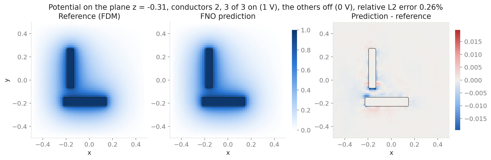
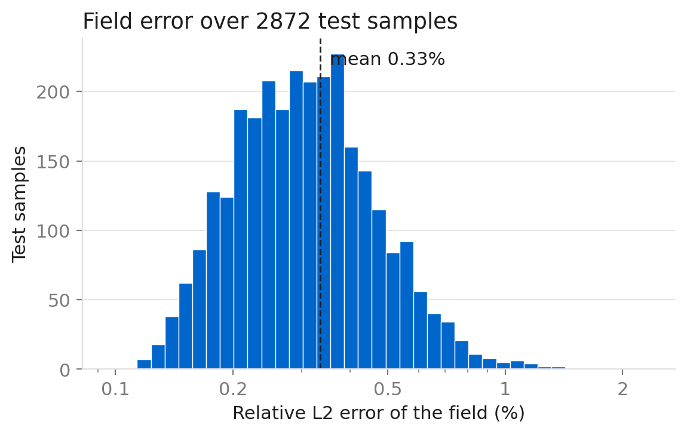
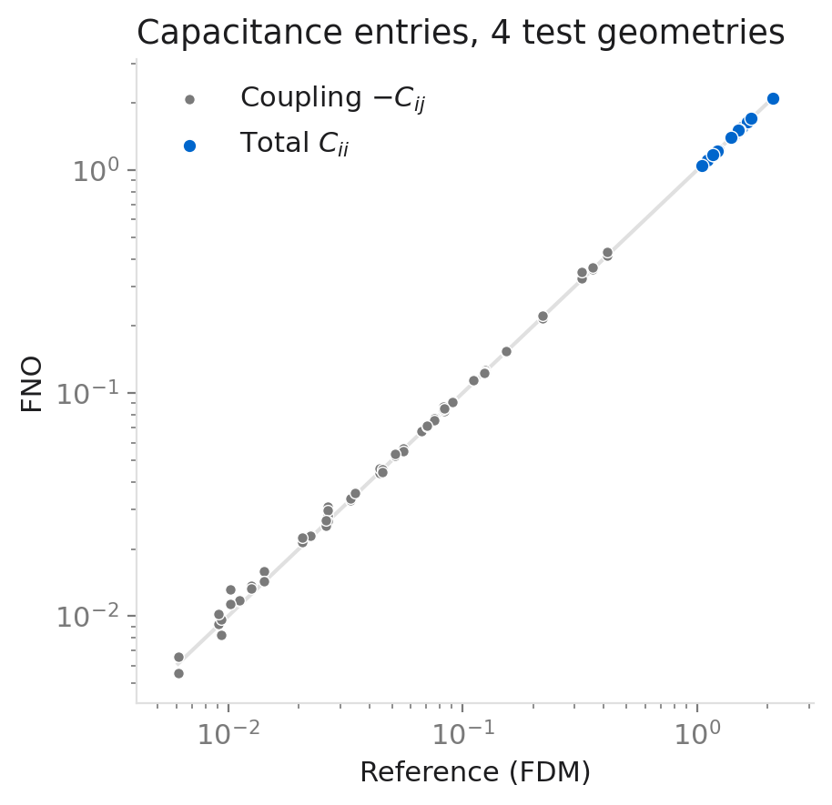

A chip has many conductors close together. To know how they talk to each other, we need their **capacitance matrix**. The usual way is to solve the Laplace equation once for every conductor, which is slow when the layout changes often. A **neural operator** learns the map from a layout to its solution. After training, one forward pass replaces one solve.

In this post I build the whole pipeline from scratch in PyTorch: a finite-difference solver that makes the data, a Fourier neural operator (FNO), and a capacitance computation that works the same way on the solver's fields and on the model's fields. The test layouts are new random layouts that the model has never seen.

## 1. The problem

The domain is the box $[-0.5, 0.5]^3$. Its walls are grounded ($\varphi = 0$). Inside are $K = 3$ to $8$ conductors. Each conductor is an axis-aligned box: 70% are thin wires (long in $x$ or $y$), 30% are blocks. Their sizes and positions are random, they do not touch, and they stay away from the walls. Every layout is different.

Some conductors are **on** (1 V) and the rest are **off** (0 V). The potential $\varphi$ between them solves

$$
\Delta \varphi = 0, \qquad \varphi = 1 \text{ on the on conductors}, \qquad \varphi = 0 \text{ on the off conductors and the walls}.
$$

**Capacitance.** Turn on only conductor $j$. The charge that appears on conductor $i$ is $C_{ij}$. So $C$ is a $K \times K$ matrix. $C_{ii} > 0$ is the total capacitance of conductor $i$, and $C_{ij} < 0$ ($i \ne j$) is the coupling between two conductors. I compute the charge with the **discrete Gauss law**: apply the same 7-point Laplacian that the solver uses to the field, and add the result over the grid nodes of each conductor. Because the discrete Laplacian is symmetric, the solver's $C$ is symmetric too, which is a free check. The same function works on a predicted field, so the model's $C$ is computed exactly like the reference $C$.

**Patterns.** For $C$ we only need the $K$ patterns with one conductor on. But I want the model to give the field for any on/off pattern directly. So each training layout has $2K$ patterns: the $K$ single ones, plus $K$ random patterns with 2 to $K$ conductors on. The solver solves every pattern directly. **Every field and charge in this post is one model output for one input.** I never add up single-conductor fields to make a multi-conductor field.

## 2. The data: a finite-difference solver

The solver uses the standard 7-point finite-difference Laplacian on a uniform grid with 64 cells per side ($65^3$ nodes). The conductor corners lie on grid nodes, so there is no staircase error at the conductor surfaces. The linear system is solved with conjugate gradients and a Jacobi preconditioner in double precision.

I checked the solver in three ways before making any data:

- **Manufactured solution** with a variable coefficient $\varepsilon = 1 + x^2$: the maximum error drops by exactly $4\times$ when $h$ is halved (order 2.00), in 2D up to 512 cells and in 3D up to 128 cells.
- **Concentric spheres** ($a = 0.2$, $b = 0.45$), where the exact capacitance is $4\pi ab/(b-a)$. The spheres become staircases on the grid, so here the error is only first order: 2.5% at 128 cells and 1.2% at 256 cells. This is why I use box-shaped conductors that fit the grid.
- **Structure of $C$**: symmetric to about $10^{-10}$, with $C_{ii} > 0$, $C_{ij} < 0$ and positive row sums.

The training set has 4000 layouts (43,934 patterns) and the test set has 256 new layouts (2872 patterns). Fields are stored in float16 to save space. This changes the reference $C$ by about $5 \times 10^{-5}$ (relative), far below the model errors below.

## 3. The Fourier neural operator

The FNO (Li et al., ICLR 2021) treats the input as a function on the grid and builds the output in a few layers. First a pointwise linear map $P$ lifts the input channels $a(x)$ to $c$ channels. Then each layer does

$$
v_{\ell+1}(x) = \sigma\Big( W_\ell\, v_\ell(x) + \mathcal{F}^{-1}\big[ R_\ell \cdot \mathcal{F}[v_\ell] \big](x) \Big).
$$

- $\mathcal{F}$ is the FFT over the three space directions.
- $R_\ell$ multiplies each kept Fourier mode by a learned complex $c \times c$ matrix. Only the lowest modes are kept, here 12 per direction. The rest are set to zero.
- $W_\ell$ is a pointwise linear map. It keeps the local detail that the cut-off Fourier part cannot hold.
- $\sigma$ is GELU (not used after the last layer).

At the end, a small pointwise network $Q$ maps the $c$ channels to one number per node. The Fourier part sees the whole box in every layer, and its weights live on frequencies, not on grid nodes. So the same weights can be run on a different grid, although that alone does not keep the accuracy.

**My setup.**

- **Input**, 7 channels per node: the coordinates $x, y, z$; a mask of the on conductors $M_\text{on}$; a mask of the off conductors $M_\text{off}$; and the distance to the nearest on conductor and to the nearest off conductor (computed exactly, since the conductors are boxes). The distances tell the network "how far am I from 1 V and from 0 V" without having to work it out from the masks.
- **Size**: width $c = 32$, 12 modes per direction, 8 Fourier layers. That is 113 million real parameters (each complex weight counts as two). Almost all of them are in the $R_\ell$.
- **Boundary values are exact.** The network output $\text{NN}(x)$ is not used as the potential directly. Instead

$$
\varphi(x) = M_\text{on}(x) + \big(1 - M_\text{on}(x) - M_\text{off}(x)\big)\, b(x)\, \text{NN}(x), \qquad b(x) = \prod_{i=1}^{3} \big(1 - 4x_i^2\big).
$$

  On an on conductor this gives 1, on an off conductor 0, and on the walls $b = 0$ gives 0. So the model can only make mistakes in the free space, never on the boundary.
- **Training**: loss = relative $L^2$ error of the field per sample, AdamW (learning rate $10^{-3}$, short warm-up, then cosine decay), batch 4, 351,076 steps (about 32 passes over the training patterns).

## 4. First check: 2D Darcy flow

Before the 3D problem, I checked the FNO code on the 2D Darcy benchmark of the FNO paper: $-\nabla\cdot(a\nabla u) = 1$ on the unit square, where $a$ is 12 or 3 depending on the sign of a Gaussian random field. I made the data with the same solver (on $421^2$ nodes, used at $85^2$) and followed the paper's training setup: 1000 training and 100 test samples, 12 modes, width 32, 4 layers, 500 epochs.

| | relative $L^2$ test error |
|---|---|
| FNO paper, $85 \times 85$ | about $1.1 \times 10^{-2}$ |
| my code and data | $0.88 \times 10^{-2}$ |

The data are not the same (my own random fields and solver), so the numbers should be close, not equal. They are close, so the FNO code works as intended.

## 5. Results on new layouts

All numbers are on the 256 test layouts, which the model never saw.

| quantity | mean | max |
|---|---|---|
| field, one conductor on (1436 patterns) | 0.30% | 2.3% |
| field, several conductors on (1436 patterns) | 0.37% | 1.5% |
| total capacitance $C_{ii}$ | 0.31% | 5.6% |
| coupling error $\lvert\Delta C_{ij}\rvert / C_{ii}$ | 0.11% | |
| coupling, relative, only $\lvert C_{ij}\rvert \ge 0.05\, C_{ii}$ | 1.4% | 13% |
| conductor charges, several on, $\lVert \Delta Q \rVert / \lVert Q \rVert$ | 1.09% | 6.6% |

Field errors are relative $L^2$ errors over the whole box. The $C$ errors are relative to the reference $C$ from the solver on the same grid.

**A typical field.** The figure shows the test pattern with the median error among the patterns that have several conductors on and at least one off. Here conductors 2 and 3 are on and conductor 1 is off.

The same layout as the plane moves through the box:

**All test patterns.** 99.4% of the 2872 test patterns have a field error below 1%.

**Capacitance.** I saved the full fields of four test layouts. Their capacitance entries, model against solver:

**What the numbers say.**

- **The field is easy, the capacitance is harder.** A mean field error of 0.3% gives a mean $C_{ii}$ error of 0.3%, but the worst $C_{ii}$ is off by 5.6%, while the worst field is off by only 2.3%. The charge comes from the slope of the field right at the conductor surface. That is a thin layer of nodes, and it carries little weight in the field error.
- **Small couplings are the hardest.** Measured against the total capacitance, coupling errors are tiny (0.11%). Measured against the coupling itself, they are larger (1.4% on average, 13% at worst), because a small coupling is a small difference of fields.
- **More conductors on, larger charge error.** On the four saved layouts, the charge error $\lVert \Delta Q \rVert / \lVert Q \rVert$ is 0.37% when one conductor is on and 0.75% when several are on. The charges themselves are not smaller in the multi-conductor patterns, so this is a real increase in error, not a small denominator. My guess is that every on conductor adds its own surface error, but four layouts are not enough to be sure.

## 6. Limits

- **One training run.** I trained once with one random seed, so differences of 10–20% between numbers may be noise.
- **One grid.** Training and every result here use 64 cells per side. Running the trained model on a finer grid does not by itself keep the capacitance accurate, so I make no claim about other resolutions.
- **Errors are against the discrete solution.** The reference is the finite-difference solution on the same grid, not the exact continuous capacitance. The solver's own discretization error is a separate question (see the sphere check in section 2).
- **Simple geometry.** Only axis-aligned boxes, one dielectric ($\varepsilon = 1$), and voltages of 0 or 1 V.

## Summary

- A finite-difference solver, checked against a manufactured solution (order 2.00) and concentric spheres, makes the data: 4000 random 3D layouts with 3 to 8 conductors.
- A Fourier neural operator with exact boundary values maps a layout and an on/off pattern to the potential. The same code reproduces the FNO paper's 2D Darcy result ($0.88 \times 10^{-2}$ against about $1.1 \times 10^{-2}$).
- On 256 new layouts: 0.30% field error with one conductor on, 0.37% with several on, and 0.31% error in the total capacitance, all read directly from model outputs.
- The weak spots are the worst cases of $C$ (up to 5.6%), small couplings, and the charges when many conductors are on.
